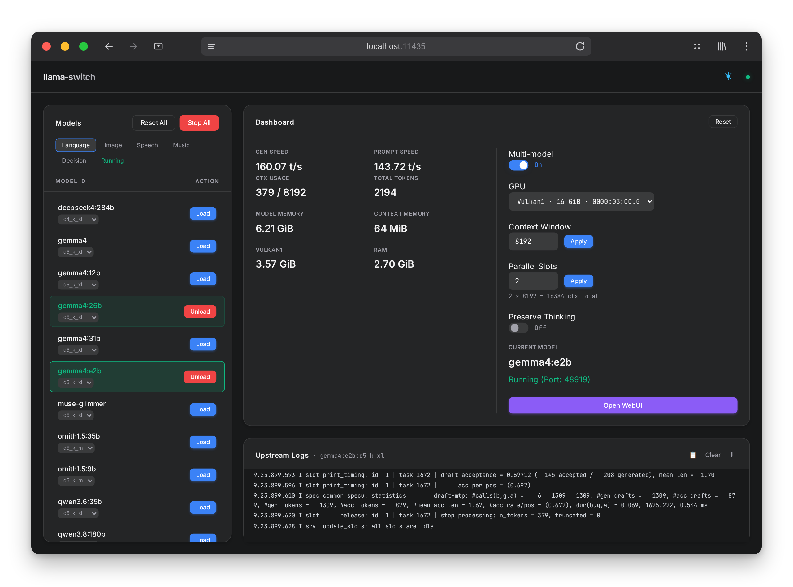

# Llama Switch



One dashboard and one OpenAI-compatible endpoint for local engines: [llama.cpp](https://github.com/ggerganov/llama.cpp), [stable-diffusion.cpp](https://github.com/leejet/stable-diffusion.cpp), [qwentts.cpp](https://github.com/ServeurpersoCom/qwentts.cpp) and [audio.cpp](https://github.com/0xShug0/audio.cpp). Several models run at once, each on its own port and cards.

## Installation

```bash
curl -L -o ~/.local/bin/llmsw https://github.com/architector1324/llama-switch/releases/latest/download/llmsw-linux-amd64
chmod +x ~/.local/bin/llmsw
```

On Windows, take `llmsw-windows-amd64.exe` from [Releases](https://github.com/architector1324/llama-switch/releases). Or build it, with Go 1.26+:

```bash
git clone https://github.com/architector1324/llama-switch.git
cd llama-switch/src && CGO_ENABLED=0 go build -trimpath -ldflags "-s -w" -o ~/.local/bin/llmsw .
```

At runtime: `llama-server`, plus the engines of the sections you use. Optional: `ffmpeg` (audio uploads that are not WAV), `vulkaninfo` (PCI addresses in the GPU picker).

## Usage

```bash
llmsw serve -f config.yaml --watch     # dashboard and API on http://localhost:11435
```

### Terminal

```bash
llmsw list                             # models in the config
llmsw ps                               # models that are up
llmsw ps gemma4                        # everything the dashboard shows of one
llmsw stop gemma4                      # or: llmsw stop --all
```

`run` works with a model of any type, loading it first:

```bash
llmsw run gemma4                                         # chat session, /bye to leave
llmsw run gemma4 "Say hi in three words"
llmsw run gemma4 photo.png "What is in the picture?"     # images, audio, video
git diff | llmsw run qwen3.6:35b --system "You write commit messages." "Write one"
llmsw run z-image "a red cat on a windowsill" --size 1024x1024 > cat.png
llmsw run mage-flow-edit cat.png "make the cat black"
llmsw run qwen3-tts "Hello there" --voice Kore
llmsw run qwen3-asr meeting.mp3
cat ticket.txt | llmsw run clef:9b "Is this urgent?"
```

- Files named in the prompt go along: an `llm` gets images, audio and video, an `sd` model edits the images. Piped text is sent as is.
- Images and audio go to `-o`, to stdout in a pipe, or else to `MODEL-TIME.ext`. Audio is played (`--no-play`). Code blocks of an answer are saved the same way (`--no-save`).
- The dashboard's settings are flags: `--gpu`, `--ctx`, `--parallel`, `--preserve-thinking`, `--size`, `--hires`, `--frames`, `--single`.
- Flags go anywhere after `run`. After `--`, everything is the prompt.
- `--verbose` prints timings to stderr, `llmsw run -h` lists every flag.
- The server is found at `LLMSW_HOST`, `localhost:11435` by default.

Fish completion knows the models, each type's flags, the cards and the sizes:

```fish
llmsw completion fish > ~/.config/fish/completions/llmsw.fish
```

### Dashboard

Open `http://localhost:11435`, pick a section and a model, set its GPU and context, click **Load**. Changing a field restarts the model with it. The microphone works only on `localhost`, since the page is served over plain http.

### Service

```bash
cp llama-switch.service ~/.config/systemd/user/
systemctl --user enable --now llama-switch
journalctl --user -u llama-switch -f
```

The unit runs `llmsw serve` on `~/.config/llama-switch/config.yaml` with `--watch`.

### Server flags

| Flag | Default | |
| --- | --- | --- |
| `-H`, `--host` | `localhost` | interface for the UI and the engines |
| `-p`, `--port` | `11435` | UI port. Engines get a free port each |
| `-c`, `--ctx` | `4096` | default context window, per slot |
| `-np`, `--parallel` | `1` | default slots |
| `-f`, `--config` | `config.yaml` | config file |
| `-w`, `--watch` | off | reload the config on change, stopping every model |

## Configuration

Up to six sections, `llm`, `sd`, `tts`, `stt`, `music` and `decision`. Each model maps quants to command lines:

```yaml
llm:
  qwen-3:
    q4_k_m: llama-server --host ${HOST} --port ${PORT} ${DEVICES} -c ${CTX} --parallel ${PARALLEL} -ngl 99 -m /path/to/qwen3-q4_k_m.gguf
    q8_k_xl: llama-server --host ${HOST} --port ${PORT} ${DEVICES} -c ${CTX} --parallel ${PARALLEL} -ngl 99 -m /path/to/qwen3-q8_k_xl.gguf
  gemma-3:
    q4_k_m: llama-server --host ${HOST} --port ${PORT} ${DEVICES} -c ${CTX} --parallel ${PARALLEL} -ngl 99 -m /path/to/gemma-3-q4_k_m.gguf --mmproj /path/to/gemma-3-mmproj.gguf

sd:
  z-image:
    q8_0: sd-server -l ${HOST} --listen-port ${PORT} ${DEVICES:--backend diffusion=Vulkan1,te=Vulkan0,vae=Vulkan0} -W ${WIDTH} -H ${HEIGHT} ${HIRES:--hires --hires-denoising-strength 0.5} --diffusion-model /path/to/z_image_turbo-Q8_0.gguf --llm /path/to/Qwen3-4B-Q8_0.gguf --vae /path/to/ae.safetensors --steps 8 --cfg-scale 1.0

tts:
  qwen3-tts:
    q8: tts-server --host ${HOST} --port ${PORT} --max-new ${FRAMES} --model /path/to/qwen-talker-Q8_0.gguf --codec /path/to/qwen-tokenizer-Q8_0.gguf

stt:
  nemotron-asr:
    f16: audiocpp-server --host ${HOST} --port ${PORT} ${DEVICES} --config /path/to/nemotron-asr.json --busy-timeout-ms 0

music:
  minimax-music3:
    q4: audiocpp-server --host ${HOST} --port ${PORT} ${DEVICES} --config /path/to/music.json --busy-timeout-ms 0

decision:
  clef:
    q8_0: llama-server --host ${HOST} --port ${PORT} ${DEVICES} -c ${CTX} --parallel ${PARALLEL} -ngl 99 -m /path/to/Clef-Flash-Q8_0.gguf
```

The first quant is the default and goes by the bare id (`qwen-3`). The others get a suffix (`qwen-3-q8_k_xl`). Ids are global. A duplicate in a later section is skipped.

| Placeholder | Types | Becomes |
| --- | --- | --- |
| `${HOST}`, `${PORT}` | all | the interface and a free port |
| `${CTX}` | `llm`, `decision` | context per slot times slots, for `-c` |
| `${PARALLEL}` | `llm`, `decision` | the slot count |
| `${DEVICES}` | all | the chosen card: `-dev Vulkan1`, `--backend vulkan --device 1` |
| `${DEVICES:<flags>}` | all | the same, or `<flags>` with **All GPUs** or **Profile**. For `sd` it names the roles |
| `${PRESERVE_THINK}` | `llm` | `--reasoning-preserve` or `--no-reasoning-preserve` |
| `${FRAMES}` | `tts` | the frame cap |
| `${WIDTH}`, `${HEIGHT}` | `sd` | the output size |
| `${HIRES}`, `${HIRES:<flags>}` | `sd` | `--hires` or `<flags>` with Hires Fix on, nothing with it off |

## API

A request that names a `model` loads it first. One with no model goes to the running model of that kind.

| Endpoint | Section |
| --- | --- |
| `/v1/models` | all |
| `/v1/chat/completions`, `/v1/completions`, `/v1/responses` | `llm` |
| `/v1/images/*`, `/sdapi/v1/*`, `/sdcpp/v1/*` | `sd` |
| `/v1/audio/speech`, `/v1/audio/voices` | `tts` |
| `/v1/audio/transcriptions`, `/v1/audio/translations` | `stt`, or `llm` with llama-server's ASR |
| `/v1/tasks/*` | `music` |
| `/v1/systemone` | `decision` |

| Management | |
| --- | --- |
| `GET /api/status[?model=]` | running instances and settings |
| `POST /api/start` | start a model |
| `POST /api/stop[?model=]` | stop one or all. The reply lists them |
| `POST /api/reset[?model=\|?kind=]` | settings back to defaults |
| `POST /api/multi` | `{"multi": false}` to keep one model at a time |
| `GET /api/logs[?model=]`, `POST /api/logs/clear[?model=]` | a model's log |
| `GET /api/devices` | the cards |
| `GET /api/config` | the config |
